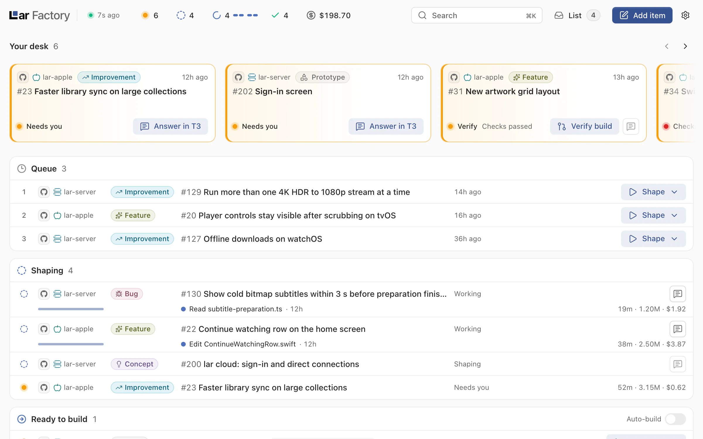

  <picture>
    <source media="(prefers-color-scheme: dark)" srcset=".github/assets/lar-factory-on-dark.png">
    
  </picture>

Your software factory, running on your Mac.

  <a href="https://github.com/maddec01/lar-factory/releases/latest"><strong>Download</strong></a> ·
  <a href="https://lar.works/factory">Website</a>

  <picture>
    <source media="(prefers-color-scheme: dark)" srcset=".github/readme/board-dark.webp">
    
  </picture>

Lar Factory lets AI agents turn your issues and ideas into reviewed pull requests. Shape the work on a
board, start a build when it's ready, and merge every pull request yourself.

## What you get

- **One board for all the work.** Items are grouped by stage, and your desk on top shows the questions
  agents need answered and the changes waiting for you to verify.
- **Shaping before building.** Factory reads the issue and the code, and asks you only what it can't
  decide. Small changes end in a Ready brief; bigger ideas become a concept map of research, decisions and
  builds.
- **Builds in isolation.** Start build opens a fresh worktree from your latest default branch, then plans,
  builds, runs your checks and reviews the change before opening a pull request.
- **You keep the merge button.** Visible or risky changes come with steps to verify, and every build ends
  as a pull request you merge.
- **Your tracker stays the source of truth.** Works with GitHub Issues and Azure DevOps through your
  existing login, and writes the agreed brief back to the issue.
- **Nothing to install in your repositories.** Builds follow your scripts, manifests, CI and tests.
  Projects, settings and work records stay on your Mac.

## Get started

1. Download the Mac app (Apple silicon) from [GitHub Releases](https://github.com/maddec01/lar-factory/releases/latest).
2. Install and open [T3 Code](https://t3.codes): Factory's agents run there, with the models and access
   you set up.
3. Sign in to your tracker with `gh auth login` (GitHub) or `az login` (Azure DevOps).
4. Open Lar Factory and add a project in **Settings > Projects**.

## Contributing

Build from source and cut releases with [CONTRIBUTING.md](CONTRIBUTING.md). Report bugs and ideas in
[Issues](https://github.com/maddec01/lar-factory/issues).

## Credits and licence

[MIT](LICENSE). Lar Factory copies or ports work from [Matt Pocock](https://github.com/mattpocock/skills)
(most skills), [Addy Osmani](https://github.com/addyosmani/agent-skills) (review and hardening checklists),
[Lauren Tan](https://github.com/cursor/plugins/tree/main/pstack) (`unslop`), [T3 Tools](https://github.com/pingdotgg/t3code)
(the desktop app) and [coss](https://github.com/cosscom/ui) (base components), all MIT. Notices are in
[THIRD_PARTY_NOTICES.md](THIRD_PARTY_NOTICES.md); [UPSTREAM.md](UPSTREAM.md) records each Copy and Port. The
factory idea draws on ZazenCodes' [Build Your Own AI Software Factory](https://www.youtube.com/watch?v=ctoaIC4LHmI).
